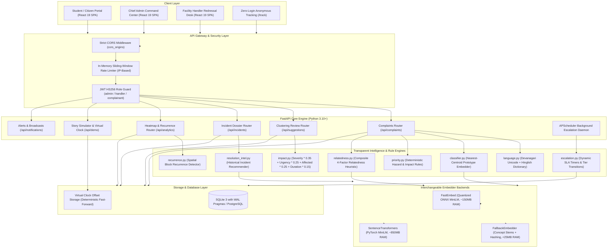
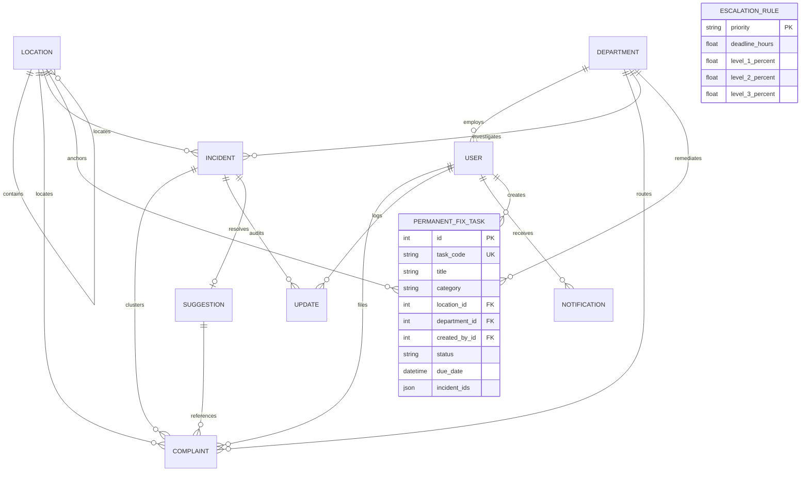
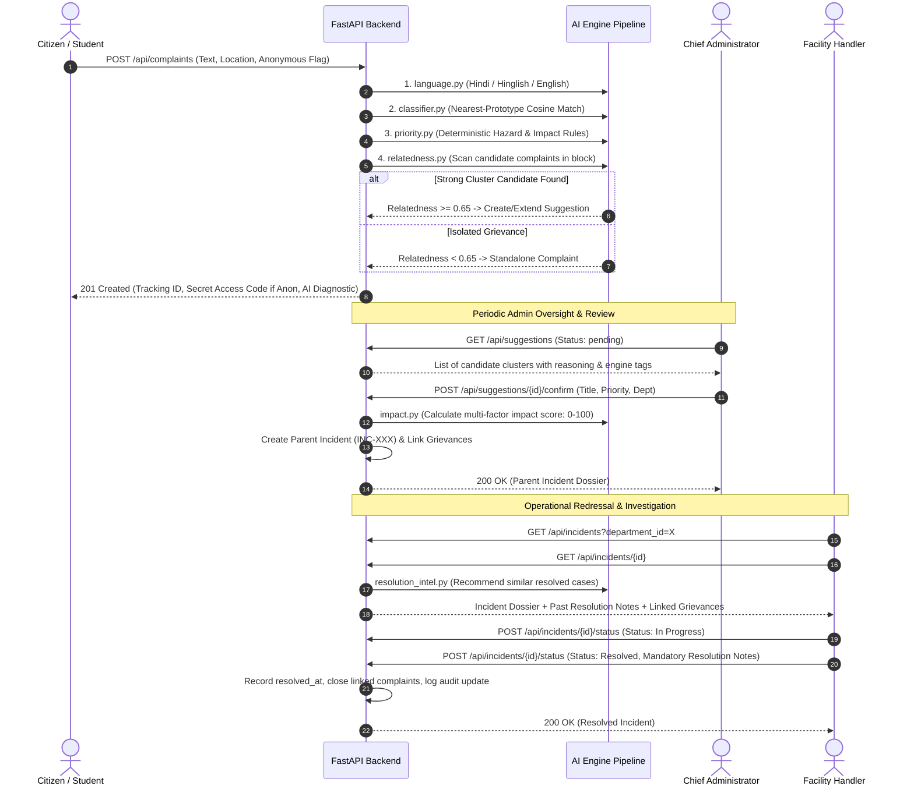
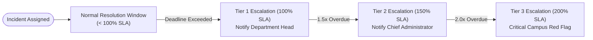

# Shikayat Karo System Architecture & Technical Design

This document details the software architecture, data models, state machines, algorithmic formulations, and infrastructure workflows powering **Shikayat Karo (शिकायत Karo)**.

---

## 1. High-Level System Architecture



---

## 2. Data Models & Entity Relationships



### Key Data Entities
1. **`users`**: Platform users categorized into three RBAC roles: `complainant` (citizen), `handler` (department facility incharge), and `admin` (chief oversight). Passwords stored via salted `bcrypt`.
2. **`locations`**: Hierarchical 2D spatial tree (`campus` $\rightarrow$ `block` $\rightarrow$ `floor` / `area`). Each node maintains spatial coordinates (`grid_x`, `grid_y`) for spatial risk heatmap rendering.
3. **`complaints`**: Individual grievance filings. Supports anonymous submissions (stores salted `access_code_hash`; `complainant_id` is strictly `NULL`). Caches text embedding vectors and priority reasoning.
4. **`suggestions`**: Candidate clusters generated by the multi-factor heuristic. Caches constituent complaint IDs, composite confidence score, heuristic reasons, and generation engine (`fallback` vs `neural`).
5. **`incidents`**: Parent incident dossiers created upon administrator confirmation of a suggestion or manual grouping. Calculates multi-factor impact score, assigns department, sets SLA deadlines, and tracks linked citizen grievances.
6. **`updates`**: Immutable audit log capturing state transitions, assignments, escalations, and resolution notes.
7. **`escalation_rules`**: Priority SLA definitions (Critical 4.0h, High 24.0h, Medium 72.0h, Low 168.0h) and automated escalation percentages (100%, 150%, 200%).
8. **`permanent_fix_tasks`**: Tracked engineering overhaul tasks generated by the recurrence engine when a facility block suffers $\ge 3$ incidents in 30 days.

---

## 3. End-to-End Complaint-to-Incident Lifecycle



### State Machine Transitions:
- **Individual Grievance**: `Submitted` $\rightarrow$ `AI Analysed` $\rightarrow$ `Assigned` (when clustered) $\rightarrow$ `Under Investigation` $\rightarrow$ `In Progress` $\rightarrow$ `Resolved` $\rightarrow$ `Closed`.
- **Parent Incident**: `Submitted` $\rightarrow$ `AI Analysed` $\rightarrow$ `Assigned` $\rightarrow$ `Under Investigation` $\rightarrow$ `In Progress` $\rightarrow$ `Resolved` $\rightarrow$ `Closed`. *(Note: Status `Awaiting Info` temporarily pauses the virtual SLA clock).*

---

## 4. Algorithmic Formulations

### A. Multi-Factor Composite Relatedness Heuristic
Grievances are clustered using a 4-dimensional composite score:

$$\text{Score} = 0.45 \cdot S_{\text{text}} + 0.25 \cdot S_{\text{loc}} + 0.15 \cdot S_{\text{time}} + 0.15 \cdot S_{\text{cat}}$$

Where:
- $S_{\text{text}} = \max(0, \cos(\mathbf{v}_1, \mathbf{v}_2))$: Cosine similarity of embedding vectors.
- $S_{\text{loc}} = 1.0$ if exact location match; $0.6$ if same campus block ancestor; $0.0$ if separate blocks.
- $S_{\text{time}} = \max(0, 1 - \frac{\Delta t}{72\text{ hours}})$: Time proximity decay over 72 hours.
- $S_{\text{cat}} = 1.0$ if exact category match; $0.0$ otherwise.
- **Hard Negative Guard**: If both location match is $0.0$ and category match is $0.0$, the score is strictly clamped to $\le 0.40$. Clustering requires $\text{Score} \ge 0.65$.

### B. Multi-Factor Incident Impact Assessment
Parent incident impact is quantified on a transparent scale $[0, 100]$:

$$\text{Impact} = 0.35 \cdot \text{Severity} + 0.25 \cdot \text{Urgency} + 0.25 \cdot \text{Affected} + 0.15 \cdot \text{Duration}$$

Where:
- **Severity**: Base priority weight (`Critical`: 100, `High`: 75, `Medium`: 50, `Low`: 25).
- **Urgency**: Scaled from reported urgency tokens and elapsed open hours.
- **Affected**: Citizen footprint, normalized as $\min(100, 20 \cdot \log_2(1 + N_{\text{citizens}}))$.
- **Duration**: Aging factor, capped at 100 after 168 hours (7 days).

---

## 5. SLA Escalation Tiers & Virtual Clock Simulator



- **Deadlines**: Critical (4h), High (24h), Medium (72h), Low (168h).
- **Virtual Clock**: The backend maintains a deterministic in-process time offset (`get_current_time()`, `advance_time(hours)`, `reset_time()`). This allows interactive demonstration of SLA breaches without waiting days for real-world clocks to expire.

---

## 6. Recurrence Detection & Root-Cause Remediation

To prevent recurring breakdowns from turning into chronic maintenance debt, Shikayat Karo implements spatial recurrence tracking:

$$\text{Recurring Condition} = \Big( \text{Count}(\text{Incidents})_{\text{block}, \text{category}, \Delta t \le 30\text{d}} \ge 3 \Big)$$

- **Ancestry Rollup**: The algorithm maps sub-areas (e.g. `Hostel Block B - First Floor`, `Mess Dining Hall`) to their parent block (`Hostel Block B`).
- **Remediation Action**: Administrators can click **"Needs Permanent Fix"** on any flagged recurring row to schedule a `PermanentFixTask` assigned to a designated department with a strict due date (e.g. 14 days) and audit logging.

---

## 7. Zero-Knowledge Anonymous Privacy Architecture

To encourage fear-free reporting of sensitive campus grievances (e.g. ragging, harassment, sanitation failure), the platform guarantees zero identity leakage:

```text
[Citizen Submits Anonymously]
       │
       ├──> Generate 8-character uppercase hex code: C = "A4F8B291"
       ├──> Compute salted bcrypt hash: H = bcrypt_hash(C)
       ├──> Write Complaint record to Database:
       │      complainant_id = NULL
       │      access_code_hash = H
       │      is_anonymous = True
       │
       └──> Display C exactly once to Citizen in UI
              (C is NEVER stored in database, logs, or server memory)

[Public Tracking via /track?tracking_id=CMP-0001&access_code=A4F8B291]
       │
       ├──> Query database for CMP-0001
       ├──> Verify bcrypt_check(C, record.access_code_hash)
       └──> If match: return complaint progress without complainant metadata.
```
